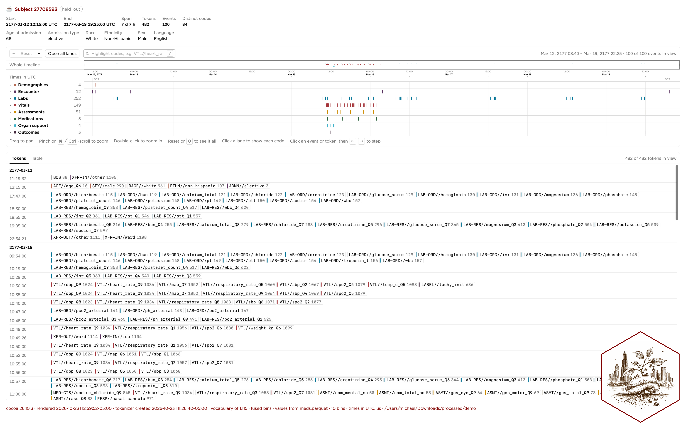
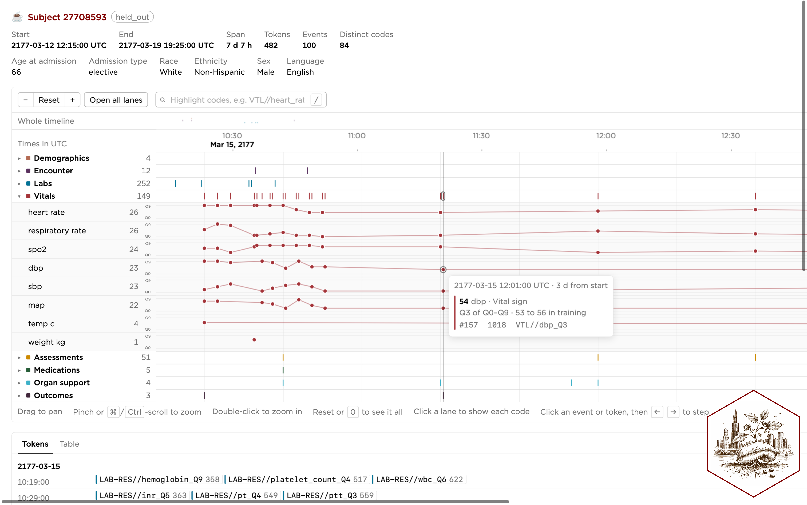

# Summary

A recent trend in predictive modeling involves representing event stream data as
sequences of tokens, learning a distribution on these sequences with generative
models, and then forecasting downstream events for novel sequences. Hospital
medicine provides a motivating example [@Guo26b], where electronic health records
(EHRs) document a variety of data collection events, including the taking of
vitals, administration of medication, assessment of patients, and receipt of lab
test results. Such records are commonly stored across a variety of specialized
tables. The `cocoa` library provides a _configurable_ framework for:

1. _collation_, collecting records from various tables into a single denormalized
   dataframe,
2. _tokenization_, converting event records including floating-point values into
   discrete sequences of integers,
3. _winnowing_, preparing data sequences for downstream inference tasks, and
4. _visualization_, creating interactive graphics of tokenized timelines.

Many of the commonly considered tokenization choices [@Lee26; @Att25; @Guo26] are
fully supported through yaml configuration. This library started with code
originally developed in 2025 [@Bur25; @Bur26] and has been subsequently extended
to support work in generative inference [@Sol26], establishing best practices for
tokenization [@Lee26], and federated learning [@Bur26b].

# Statement of need

Successful interdisciplinary research requires close collaboration between those
with domain expertise and those with technical backgrounds. Healthcare is a prime
example; complex codebases make it difficult for clinicians to audit data
processing pipelines. This can cause data leakage in a number of ways: billing
codes that only become available after discharge are sometimes inserted at
admission time [@Ram25], dates may be cast to times causing key events to be
inserted up to 24 hours prior to their occurrence, and lab results may be
inserted at the time samples are collected as opposed to when the results become
available. Our collation process is fully configurable in yaml and our downstream
visualizer makes it easy to produce interactive example timelines that can be
reviewed without touching code.

# State of the field

Many of the released tools in this area start with data in a standardized
format---such as OMOP [@Ove12], MEDS [@McD26], or CLIF [@Roj25]---and focus on
tokenization and model training. Code released with MOTOR [@Ste24] and CEHR-XGPT
[@Pan25b] used OMOP data, while @Mon25 and ETHOS-ARES [@Ren25] used MEDS. The
original ETHOS paper [@Ren24] is a notable exception; it developed a complete
tokenization pipeline hardcoded for MIMIC data [@Joh23]. McDermott et al.'s MEDS
ecosystem [@McD26] provides the closest functional overlap with the `cocoa`
library. It contains packages that support the conversion process to MEDS with a
MESSY ("MEDS-Extract Specification Syntax YAML") configuration, has functionality
for tokenizing MEDS data, and includes some visualization capabilities.

# Software design

An emphasis on configurability and usability has driven the development process.
Each of the four main commands exposed by the library's CLI---(1) `collate`, (2)
`tokenize`, (3) `winnow`, and (4) `visualize`---has a corresponding yaml
configuration file that allows for extensive customization without the need to
modify python code. Individual configuration overrides can also be passed as
command line options, to avoid the need to maintain multiple copies of a
configuration file with slight modifications.

## 1. Collation

Collation takes a collection of raw parquet or csv files and produces:

- `meds.parquet`, a single denormalized dataframe containing a record of each
  configured event, with columns `subject_id`, `time`, `code`, `numeric_value`,
  and `text_value`, and
- `subject_splits.parquet`, a dataframe that partitions each subject into the
  `train`, `tuning`, or `held_out` subsets.

## 2. Tokenization

Tokenization takes the collated data and produces chronologically ordered,
tokenized timelines for each subject. In this way, we move from irregularly
spaced tabular data to a stream of tokens akin to natural language [@Ste21 ;
@Wor25]. Configuration specifies how `numeric_value` entries should be converted
into tokens. This is commonly done by aggregating at the category level and
forming quantile-based bins using all available training data for that category.
The library supports token fusion that concatenates categories and their
associated discretized values into single tokens. The insertion of time-spacing
tokens [@Pan21] and clock tokens is also supported. This process produces:

- `tokens_times.parquet` containing the subject-level timelines, with columns
  `subject_id`, `tokens` (an ordered list of all the subjects's tokens), `times`
  (a list of the same length containing clock times corresponding to the tokens),
  and potentially additional columns depending on configuration, and
- `tokenizer.yaml` containing everything necessary to recreate the tokenizer
  object, including the dictionary of codes to integer tokens.

## 3. Winnowing

Winnowing prepares timelines for downstream inference by thresholding them at a
decision point and creating boolean flags for classification problems. We support
multiple types of thresholding including `duration_s`, the number of seconds that
have passed since the start of the timeline, `after_start_time_s`, the number of
seconds that have passed since the subject's configured start time, and
`first_occurrence`, the first occurrence of a particular token of interest (for
example, a token representing admission to the ICU). This produces
`{split}_for_inference.parquet` containing winnowed timelines where split is one
of `train`, `tuning`, or `held_out`.

## 4. Visualization

Visualization creates an interactive webpage containing a tokenized timeline. It
supports export in both html and pdf formats. See Figures \ref{fig:scrnsht} and
\ref{fig:scrnsht2} for an illustration.

# Research impact statement

This library started with code developed for projects on evaluating
representation dynamics and transferability [@Bur25] and quantifying information
at the token and event levels [@Bur26], and subsequently supported work in
generative inference [@Sol26], establishing best practices for tokenization
[@Lee26], and federated learning [@Bur26b].

# AI usage disclosure

This library was built on top of a previous
[human-engineered library](https://github.com/bbj-lab/fms-ehrs/tree/main) with
the extensive use of Claude Code, OpenAI Codex, and Github Copilot. Design
choices were made specifically to allow these tools to perform their best. Early
experimentation led to prioritizing a more modular codebase, frequent commits,
and the adoption of a test suite. This paper, however, was typed out manually.

# Acknowledgements

Compute resources used to house data and test this code were provided in part by
the Center for Research Informatics (CRI) at the University of Chicago and funded
by the Biological Sciences Division and the Institute for Translational
Medicine/CTSA (NIH UL1TR002389).

# References
